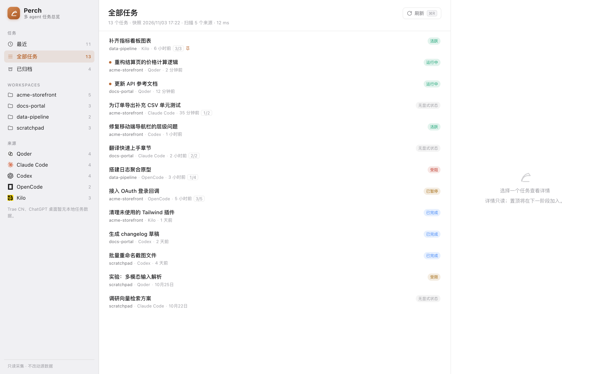
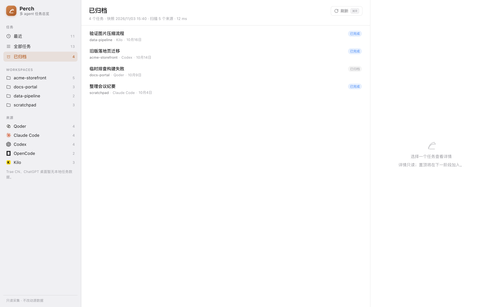
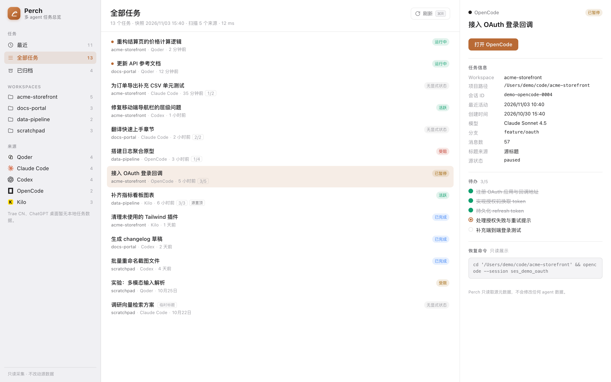

# Perch

> 多 agent 任务总览：把 Qoder、Claude Code、Codex、OpenCode、Kilo 的本地会话汇总到一处。
> 先找到任务，再决定回哪个 agent 继续。



Perch 只读取各 agent 已落盘的会话元数据，把散落在不同侧边栏里的任务放进同一个列表。
它不会写入、修改或删除任何 agent 的数据，也不发起网络请求。

如果本机使用 usage-ledger 归档过 token 用量，Perch 还会**只读**它的
`usage.db`，在任务详情里附加该会话的 token / credits / 估算值。没有安装或没有归档时，
这一块会静默隐藏，不影响任务列表。

**当前状态**：v0.1.0，早期可用版本，仅支持 macOS，尚未提供签名安装包，需要从源码构建。
功能边界与后续计划见 [ROADMAP.md](ROADMAP.md)。

## 它能做什么

- **统一任务列表**：五个来源的任务按最近活动时间平铺展示，行内标注 workspace。
- **三种视图**：最近（近 7 天）、全部任务、已归档；可按 workspace 或来源筛选。
- **实时感知**：窗口可见时每 3 秒探测源变化，变更后自动重扫并刷新界面；也可用 `⌘R` 手动刷新。
- **详情面板**：展示模型、分支、消息数、待办进度和恢复命令。
- **用量附加（可选）**：按会话关联 usage-ledger 的 token 真值、Qoder credits 与 est 估算，
  四轨分开展示、永不相加；选中单一来源时，顶部显示该来源的摘要（不同来源单位不同，
  不做跨来源汇总）。顶部的“用量报告”按钮调用 usage-ledger 自己的 `usage html`，
  在浏览器打开完整 HTML 报告（选中来源时只统计该来源）。
- **继续工作**：按来源决定激活 App 还是在终端恢复会话，命令由 Rust 侧固定模板生成。
- **只读保证**：SQLite 只读连接 + 只读 JSONL；界面脚注和详情面板都明确标注不改动源数据。

### 界面预览

| 已归档视图 | 详情面板 |
| --- | --- |
|  |  |

## 支持的来源

| 来源 | 读取位置（默认） | 继续工作的方式 |
| --- | --- | --- |
| Qoder | `~/Library/Application Support/com.qoder.app.stable/main.sqlite` | 激活 Qoder App（官方暂不支持会话级深链） |
| Claude Code | `~/.claude/projects/**/*.jsonl` 与 `~/.claude/tasks/` | 打开终端执行 `claude --resume <session-id>` |
| Codex | `~/.codex/sessions`、`archived_sessions`、`session_index.jsonl` | App 会话用 `codex://threads/<id>`；CLI 会话用终端 `codex resume <id>` |
| OpenCode | `~/.local/share/opencode/opencode.db` | App 运行中则激活 App；否则终端 `opencode --session <id>` |
| Kilo | `~/.local/share/kilo/kilo.db` | App 运行中则激活 App；否则终端 `kilo` |

各来源的字段映射、状态推断规则与已知限制见 [docs/SOURCES.md](docs/SOURCES.md)。

Trae CN 暂无本地任务数据；ChatGPT 桌面仅 Codex 会话写入本地并计入 Codex，普通聊天仍存于云端。
如果未来出现稳定的只读数据源，会以独立采集器加入。

### 用量来源（可选）

| 来源 | 读取位置（默认） | 展示方式 |
| --- | --- | --- |
| usage-ledger | `~/.local/share/usage-ledger/usage.db` | 按 `session_id` 关联到任务，分 token / credits / est 三块展示 |

路径可用 `PERCH_USAGE_DB`、`USAGE_LEDGER_DB` 或 `USAGE_LEDGER_HOME` 覆盖。
Perch 只读该库，不会触发 usage-ledger 的 sync；数据新鲜度由 usage-ledger 自己的
`usage schedule install` 或手动 `usage sync` 维护。四轨口径不同：token 真值、credits
（服务端计费）、est（估算）、activity（按项目/天，不挂任务）互不相加。

## 快速开始

要求：macOS、Xcode Command Line Tools、Rust stable、Node.js 20+。

```bash
npm install
npm run tauri dev
```

构建本地应用：

```bash
npm run tauri build
```

产物位于 `src-tauri/target/release/bundle/macos/Perch.app`（以及 `.dmg`）。
当前未做 codesign / notarize，首次打开可能需要右键 → 打开。

开发、测试、环境变量与故障排查见 [DEVELOPMENT.md](DEVELOPMENT.md)。

## 只读与隐私

- 采集只使用 SQLite `SQLITE_OPEN_READ_ONLY` + `PRAGMA query_only=ON`，JSONL 只读打开。
- usage-ledger 的 `usage.db` 同样只读打开，Perch 不会写入、迁移或触发它的 sync。
- 不读取消息正文、prompt、tool 输出、附件或思考过程；只读取标题、项目路径、时间、模型、分支、
  计数、待办 subject、状态与置顶/未读标志等元数据。用量块只读取来源、会话 ID、模型、日期与计数。
- 不发起任何网络请求，没有遥测、账号或云同步。
- 本地缓存位于 `~/Library/Application Support/app.perch.desktop/cache.db`，可随时删除重建，
  不影响源 agent 数据。标题由 agent 生成，可能包含 prompt 片段；Perch 只在本机保存。
- 详情面板的“打开”按钮不会执行前端传入的任意命令；会话 ID 会做字符集校验。

更多边界与威胁模型见 [SECURITY.md](SECURITY.md)。

## 当前不包含

- 全局置顶、标签、备注、隐藏、重命名等覆盖层操作（`overlay.db` 尚未实现）。
- 完整的用量报表、按 workspace 汇总、图表与导出；这些仍以 usage-ledger 的 `html` / CLI 为准。
- 全文搜索、跨来源自动合并、伴生 CLI。
- Windows / Linux 支持。

这些能力在 [ROADMAP.md](ROADMAP.md) 中按里程碑排列。

## 文档

| 文档 | 内容 |
| --- | --- |
| [docs/DESIGN.md](docs/DESIGN.md) | 产品与数据设计、逐源采集规格、方案取舍 |
| [ARCHITECTURE.md](ARCHITECTURE.md) | 代码结构、数据流、只读不变量、扩展点 |
| [docs/SOURCES.md](docs/SOURCES.md) | 每个来源的路径、schema、状态规则和怪癖 |
| [docs/FAQ.md](docs/FAQ.md) | 常见问题（深链限制、数据位置、卸载等） |
| [DEVELOPMENT.md](DEVELOPMENT.md) | 开发环境、命令、环境变量、演示模式 |
| [ROADMAP.md](ROADMAP.md) | 里程碑与当前进度 |
| [CHANGELOG.md](CHANGELOG.md) | 版本变更记录 |
| [CONTRIBUTING.md](CONTRIBUTING.md) | 贡献流程与只读约束 |
| [SECURITY.md](SECURITY.md) | 安全边界与漏洞报告方式 |

## 许可

[MIT](LICENSE)
