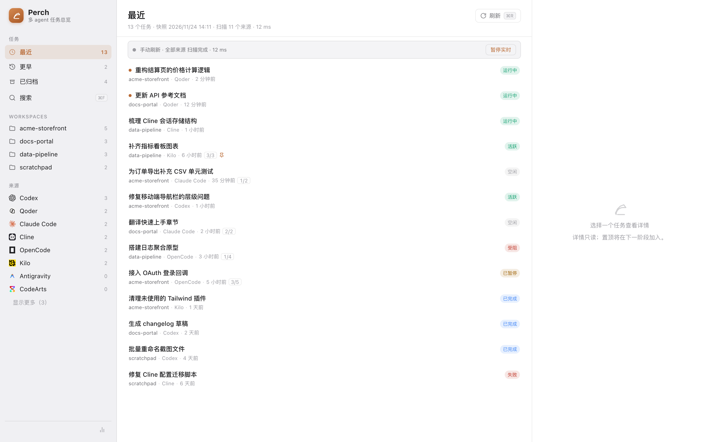
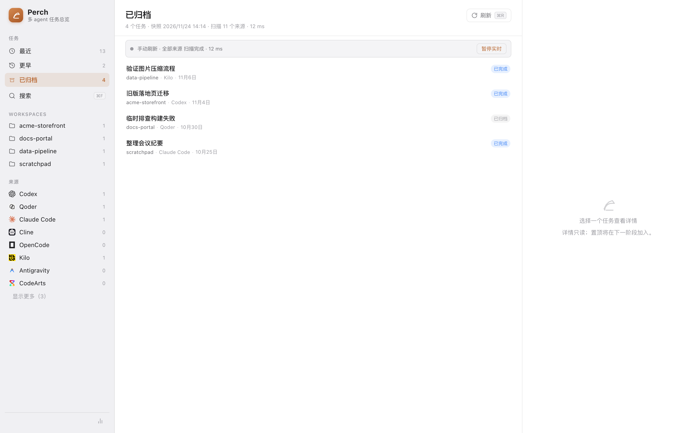
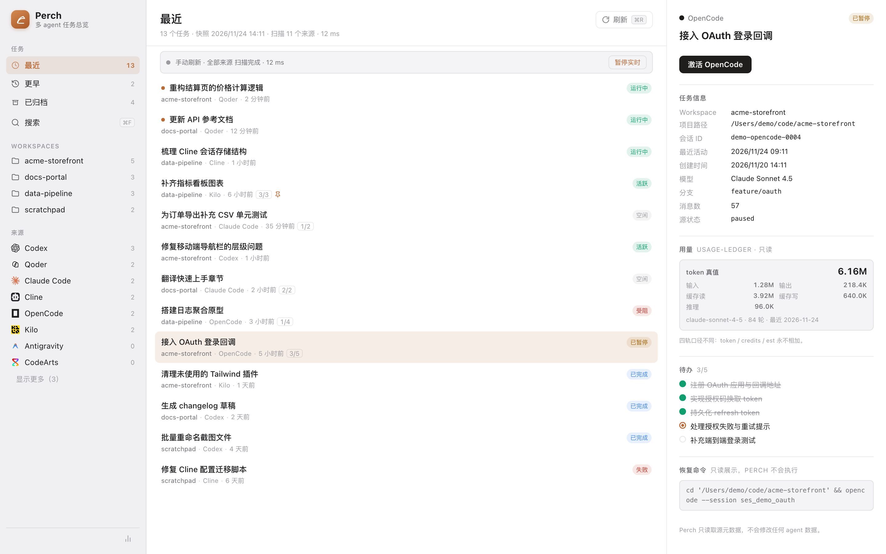

# Perch

> 多 agent 任务总览：把 Qoder、Claude Code、Codex、OpenCode、Kilo、Trae CN、Cline、Antigravity、MiniMax Code、CodeArts、CodeBuddy 的本地会话汇总到一处。
> 先找到任务，再决定回哪个 agent 继续。



Perch 只读取各 agent 已落盘的会话元数据，把散落在不同侧边栏里的任务放进同一个列表。
它不会写入、修改或删除任何 agent 的数据，也不发起网络请求。

如果本机使用 usage-ledger 归档过 token 用量，Perch 还会**只读**它的
`usage.db`，在任务详情里附加该会话的 token / credits / 估算值。没有安装或没有归档时，
这一块会静默隐藏，不影响任务列表。

**当前状态**：v0.1.0，早期可用版本，仅支持 macOS（Apple Silicon）。可从
[Releases](https://github.com/sbwkl/perch/releases/latest) 下载未签名的 `.dmg`，
或从源码构建；安装包尚未 codesign / notarize。
功能边界与后续计划见 [ROADMAP.md](ROADMAP.md)。

## 它能做什么

- **统一任务列表**：11 个来源的任务按最近活动时间平铺展示，行内标注 workspace。
- **简洁导航**：最近（近 7 天）、更早（7 天之外）、已归档、搜索；Workspaces / 来源按近 7 天会话数倒排，超过 8 项折叠；任务视图可组合 workspace / 来源筛选，长列表按页展开；用量报告由页脚图标进入。
- **搜索**：`⌘F` 或侧边栏入口打开搜索弹层，即时搜索标题、项目、路径、待办、模型、分支、状态、来源、类型与会话 ID；
  支持中文、拼音与拉丁模糊匹配；忽略当前任务视图、默认包含归档，当前 workspace / 来源筛选会叠加并显示作用域；返回全部命中并在弹层分页展示，`↑`/`↓` 选择、`Enter` 打开。
- **实时感知**：窗口可见时检查 SQLite 变化、节流计算 JSONL / 日志签名；变化经去抖与冷却后重扫，界面显示扫描来源 / 耗时并允许暂停实时刷新；`⌘R` 手动刷新优先。
- **详情面板**：展示模型、分支、消息数、待办进度、继续工作通道与恢复命令。
- **用量附加（可选）**：按会话关联 usage-ledger 的 token 真值、Qoder credits 与 est 估算，
  四轨分开展示、永不相加；选中单一来源时，顶部显示该来源的摘要（不同来源单位不同，
  不做跨来源汇总）。侧边栏页脚的用量报告图标调用 usage-ledger 自己的 `usage html`，
  在应用内嵌视图展示完整的 HTML 报告；报告是全局的，不随任务筛选变化。
- **继续工作**：点击前显示终端恢复 / 深链打开 / 仅激活 App 通道；按来源决定动作，命令由 Rust 侧固定模板生成。
- **只读保证**：SQLite 只读连接 + 只读 JSONL；详情面板标注数据边界，侧边栏不展示只读说明。

### 界面预览

| 已归档视图 | 详情面板 |
| --- | --- |
|  |  |

## 支持的来源

| 来源 | 读取位置（默认） | 继续工作的方式 |
| --- | --- | --- |
| Qoder | `~/Library/Application Support/com.qoder.app.stable/main.sqlite` | 激活 Qoder App（官方暂不支持会话级深链） |
| Claude Code | `~/.claude/projects/**/*.jsonl` 与 `~/.claude/tasks/` | 打开终端执行 `claude --resume <session-id>` |
| Codex | `~/.codex/sessions`、`archived_sessions`、`session_index.jsonl` | App 会话用 `codex://threads/<id>`；CLI 会话用终端 `codex resume <id>` |
| OpenCode | `~/.local/share/opencode/opencode.db` | App 运行中则激活 App；否则终端 `opencode --session <id>` |
| Kilo | `~/.local/share/kilo/kilo.db` | App 运行中则激活 App；否则终端 `kilo` |
| Trae CN | `~/.local/share/usage-ledger/trae-cn/events-*.jsonl` 与 `~/.trae-cn/memory/projects/**/session_memory_*.jsonl` | 激活 Trae CN App（无会话级深链） |
| Cline | `~/.cline/data/db/sessions.db` | App 会话激活 Cline App；CLI 会话终端 `cline --id <id>` |
| Antigravity | `~/.gemini/antigravity/`、`~/.gemini/antigravity-cli/` | 激活 Antigravity App（无确认的会话级恢复方式） |
| MiniMax Code | `~/.minimax/v2/sessions/`、`runtime-state.sqlite` | 激活 MiniMax Code App（无确认的会话级恢复方式） |
| CodeArts | `~/.codeartsdoer/codearts-data/opencode.db` | 激活 CodeArts App（无确认的会话级恢复方式） |
| CodeBuddy | CodeBuddy CN / IDE 日志与 genie-history | 激活 CodeBuddy App（无确认的会话级恢复方式） |

各来源的字段映射、状态推断规则与已知限制见 [docs/design-docs/source-designs/SOURCES.md](docs/design-docs/source-designs/SOURCES.md)。

Trae CN 的会话列表在服务端，本地 agent 库加密；Perch 只读 usage-ledger 的 Trae hook 事件，
并枚举 `memory/projects` 下的 `session_memory_*.jsonl` 文件名来覆盖安装 hook 前的历史会话
（读取文件名、日期目录、mtime 与首条 `intent` 摘要作为标题，不读消息正文）。
需要先安装 hook（`usage hooks install trae-cn --scope global`），未安装时该来源显示不可用。
Cline 的 CLI 与桌面 App 共用 `sessions.db`，Perch 只读其中的会话元数据（标题、项目、状态、
模型、父子关系），不读取消息正文；Cline 没有会话级深链，App 会话只能激活窗口。
ChatGPT 桌面仅 Codex 会话写入本地并计入 Codex，普通聊天仍存于云端。

### 用量来源（可选）

| 来源 | 读取位置（默认） | 展示方式 |
| --- | --- | --- |
| usage-ledger | `~/.local/share/usage-ledger/usage.db` | 按 `session_id` 关联到任务，分 token / credits / est 三块展示 |

路径可用 `PERCH_USAGE_DB`、`USAGE_LEDGER_DB` 或 `USAGE_LEDGER_HOME` 覆盖。
Perch 只读该库，不会触发 usage-ledger 的 sync；数据新鲜度由 usage-ledger 自己的
`usage schedule install` 或手动 `usage sync` 维护。四轨口径不同：token 真值、credits
（服务端计费）、est（估算）、activity（按项目/天，不挂任务）互不相加。

## 快速开始

要求：macOS、Xcode Command Line Tools、Rust stable、Node.js 20+。

```bash
npm install
npm run tauri dev
```

构建本地应用：

```bash
npm run tauri build
```

产物位于 `target/release/bundle/macos/Perch.app` 与 `target/release/bundle/dmg/*.dmg`。
当前未做 codesign / notarize，首次打开可能需要右键 → 打开。

开发、测试、环境变量与故障排查见 [DEVELOPMENT.md](DEVELOPMENT.md)。

## 只读与隐私

- 采集只使用 SQLite `SQLITE_OPEN_READ_ONLY` + `PRAGMA query_only=ON`，JSONL 只读打开。
- usage-ledger 的 `usage.db` 同样只读打开，Perch 不会写入、迁移或触发它的 sync。
- 不读取消息正文、prompt、tool 输出、附件或思考过程；只读取标题、项目路径、时间、模型、分支、
  计数、待办 subject、状态与置顶/未读标志等元数据。用量块只读取来源、会话 ID、模型、日期与计数。
- 不发起任何网络请求，没有遥测、账号或云同步。
- 本地缓存位于 `~/Library/Application Support/app.perch.desktop/cache.db`，可随时删除重建，
  不影响源 agent 数据。标题由 agent 生成，可能包含 prompt 片段；Perch 只在本机保存。
- 详情面板的“继续工作”按钮不会执行前端传入的任意命令；会话 ID 会做字符集校验。

更多边界与威胁模型见 [SECURITY.md](SECURITY.md)。

## 当前不包含

- 全局置顶、标签、备注、隐藏、重命名等覆盖层操作（`overlay.db` 尚未实现）。
- 完整的用量报表、按 workspace 汇总、图表与导出；这些仍以 usage-ledger 的 `html` / CLI 为准。
- 全文搜索、跨来源自动合并、伴生 CLI。
- Windows / Linux 支持。

这些能力在 [ROADMAP.md](ROADMAP.md) 中按里程碑排列。

## 需求、变更与文档

- 产品规格事实源：应用内用量报告见 [usage-report.md](docs/product-specs/usage-report.md)，来源覆盖见 [agent-sources.md](docs/product-specs/agent-sources.md)。
- 设计知识库：入口见 [docs/design-docs/index.md](docs/design-docs/index.md)，核心工程信念见 [core-beliefs.md](docs/design-docs/core-beliefs.md)，源设计见 [source-designs/SOURCES.md](docs/design-docs/source-designs/SOURCES.md)。
- 当前实现总图见 [ARCHITECTURE.md](ARCHITECTURE.md)；历史设计稿见 [v0.3.3-design-review.md](docs/design-docs/history/v0.3.3-design-review.md)，不作为当前验收标准。
- 变更记录见 [docs/exec-plans/completed/](docs/exec-plans/completed/)；进行中变更见 [docs/exec-plans/active/](docs/exec-plans/active/)，状态以文档头为准。
- 文档不再分配全局顺序编号。历史 `REQ-xxxx` / `CHG-xxxx` / `ADR-xxxx` 编号冻结，仅用于追溯；新增变更文档使用 `YYYY-MM-DD-<主题>.md`，开发中放 `docs/exec-plans/active/`，验证后移入 `docs/exec-plans/completed/`。
- 文档是事实源；issue / PR 中的结论若未回写仓库，对 agent 等于不存在。

## 开发约定

工作流：`main` 是保护分支，只接受合并；新特性从最新 `main` 切 `feat/<特性名>`；集成测试用临时 `tmp/integration-<特性名>` 分支，测完即删；有未提交改动时用 `git worktree` 并行开发；合并 `main` 前必须获得用户同意。完整流程见根 [AGENTS.md](AGENTS.md)。

- 产品行为变化先更新对应产品规格；新功能 / 跨模块行为变更先建变更文档并链接产品规格，验收覆盖正常 / 异常 / 边界后再写代码。
- 提交前检查：`npm run check`、`cargo fmt --all --check`、`cargo clippy -p perch-core --all-targets -- -D warnings`、`cargo test -p perch-core`。
- 测试与 demo 只允许合成数据；不得提交真实会话标题、项目路径、数据库或日志。
- 只读红线、代码风格与 PR 要求见 [CONTRIBUTING.md](CONTRIBUTING.md)；安全边界见 [SECURITY.md](SECURITY.md)。

## 文档索引

| 文档 | 内容 |
| --- | --- |
| [AGENTS.md](AGENTS.md) | 工作区地图、硬性规则与开发流程 |
| [README.md](README.md) | 项目定位、文档与开发约定 |
| [ARCHITECTURE.md](ARCHITECTURE.md) | 代码结构、数据流、只读不变量、扩展点 |
| [docs/product-specs/](docs/product-specs/) | 产品规格与验收事实源 |
| [docs/design-docs/](docs/design-docs/) | 设计知识库：状态索引、核心信念、ADR / RFC、来源设计、历史 |
| [docs/exec-plans/](docs/exec-plans/) | 进行中 / 已完成变更记录与技术债账本 |
| [docs/references/DATA-PROBE.md](docs/references/DATA-PROBE.md) | 本机只读数据探针证据 |
| [docs/FAQ.md](docs/FAQ.md) | 常见问题（深链限制、数据位置、卸载等） |
| [DEVELOPMENT.md](DEVELOPMENT.md) | 开发环境、命令、环境变量、演示模式 |
| [ROADMAP.md](ROADMAP.md) | 里程碑与当前进度 |
| [CHANGELOG.md](CHANGELOG.md) | 版本变更记录 |
| [CONTRIBUTING.md](CONTRIBUTING.md) | 贡献流程与只读约束 |
| [SECURITY.md](SECURITY.md) | 安全边界与漏洞报告方式 |

## 许可

[MIT](LICENSE)
